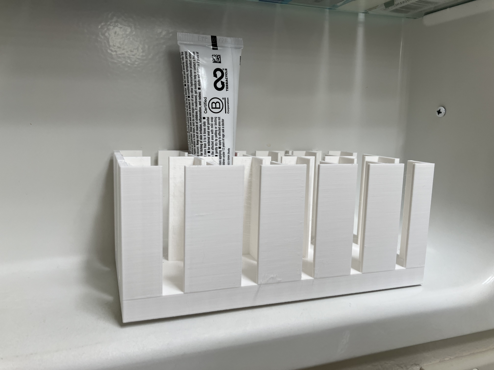
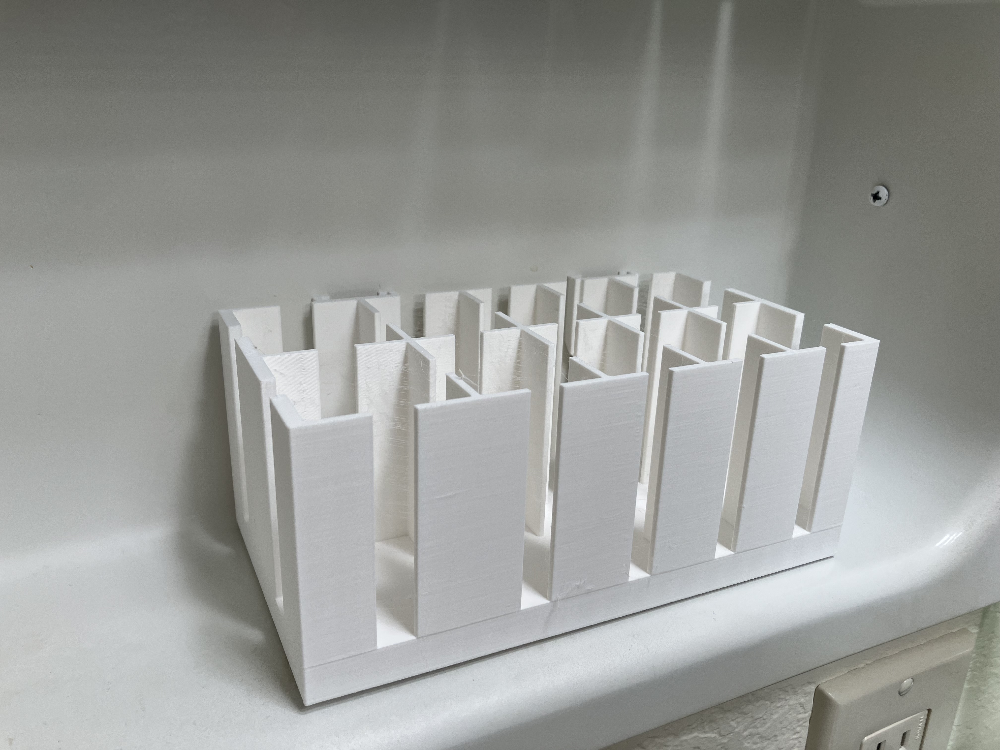
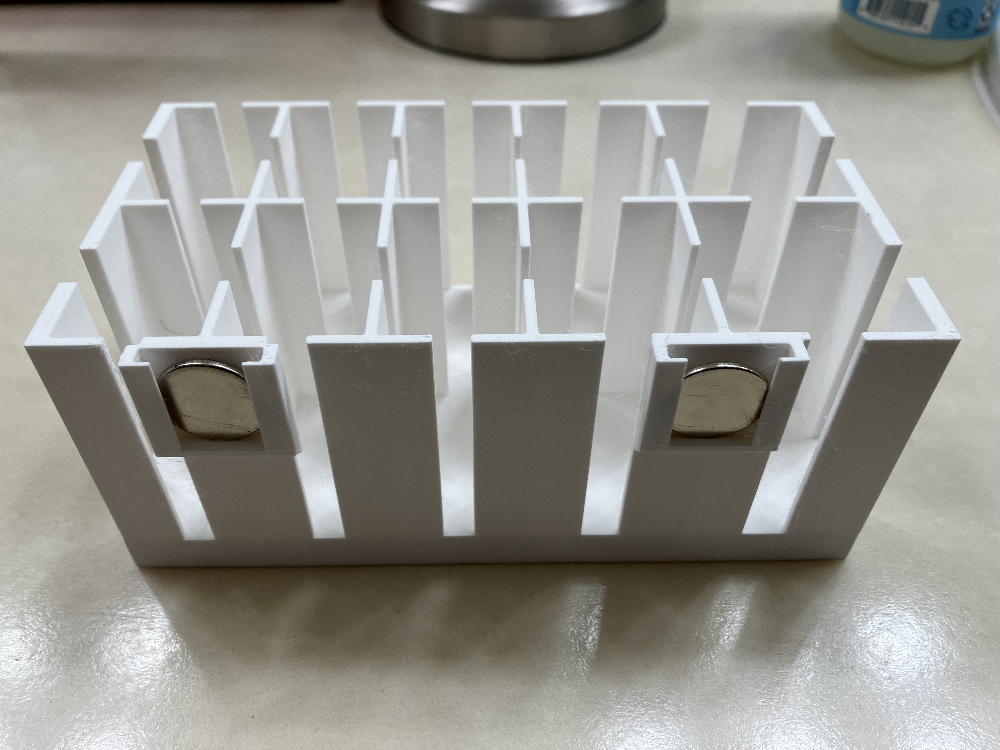
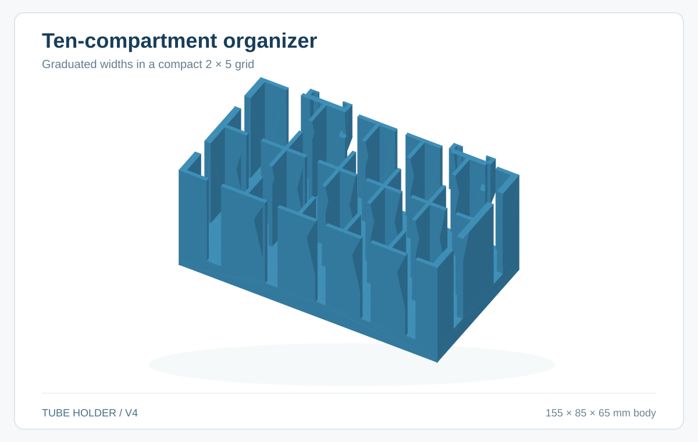
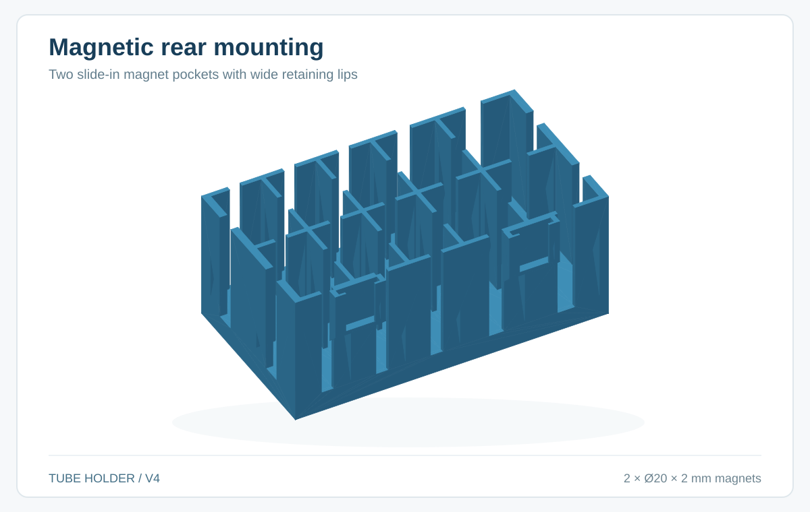

# Magnetic Medicine Tube Holder

A compact, parametric **3D-printable organizer** that keeps ointment and medicine tubes upright inside a medicine cabinet. Ten compartments have graduated widths; two slide-in magnets attach the organizer to the cabinet's steel back wall.

## Finished V4 print

<p>
  
  
  
</p>

Photographs of the actual printed organizer. CAD-derived images appear in the design section below.

## Status — successful first print

**V4 is physically tested and approved.** All intended tubes fit their compartments, the overall dimensions fit the medicine cabinet, and two **20 mm × 2 mm magnets slide perfectly into their pockets and hold the entire organizer firmly against the metal back wall**. No changes to the proven geometry are needed.

The exact tested export is [`exports/tube-holder-v4-print.stl`](exports/tube-holder-v4-print.stl). The parametric source is [`src/tube-holder.scad`](src/tube-holder.scad).

## Design and features





- **Ten compartments**, arranged two rows by five columns, with clear widths **35 / 30 / 25 / 25 / 25 mm** in each row.
- **Top-open slots in the vertical walls**, for easy tube access.
- **55 mm walls above a 10 mm base**, so the tubes project high enough to grasp in the cabinet.
- **Two external rear magnet pockets** positioned over the first internal divider inward from each corner of the long back wall.
- **5 mm rear offset** to reach the cabinet's steel back wall beyond its curved lower edge.
- **Wide retaining lips** hold the magnets while leaving part of their faces open toward the steel.

### Dimensions

| Property | Specification |
|---|---:|
| Organizer width × depth × overall height | **155 × 85 × 65 mm** |
| Maximum depth at rear magnet pockets | **90 mm** |
| Compartments | **2 rows × 5 columns = 10** |
| Clear compartment widths, left to right | **35, 30, 25, 25, 25 mm** |
| Clear compartment depth | **39.5 mm each** |
| Base height | **10 mm** |
| Wall height above base | **55 mm** |
| Internal dividers and front/back wall | **2 mm thick** |
| Left/right outer walls | **3.5 mm thick** |
| Magnet pocket rearward projection | **5 mm** |

The original design targets round or oval medicine tubes approximately 23–33 mm across. Fit depends on each tube's cross-section and your printer's dimensional accuracy.

## Mounting hardware — the exact magnets tested

**Quantity: 2**

**[Radial Magnets SKU 9404 — N35 neodymium disk, Ø20 mm × 2 mm](https://radialmagnet.com/our-magnets/neodymium-magnet-disk-n35-20mm-x-2mma)**

These are the **actual magnets installed and successfully tested** in V4. Both slip into the holders perfectly and hold the printed organizer firmly against the medicine cabinet's metal back wall. **No spacer or design change is needed.**

The pockets accept magnets from the top and retain them with two wide clips. They are outside the tube compartments, so the internal clear dimensions are not affected.

## Printing and use

The successful first print used the **standard Bambu Studio process settings without manual changes**.

### Verified print settings

| Setting | First-print configuration |
|---|---|
| Printer | Bambu Lab **P1S** |
| Nozzle | **0.4 mm**, standard flow |
| Process preset shown in Bambu Studio | **0.20mm Standard @BBL X1C** |
| Layer height (including first layer) | **0.20 mm** |
| Wall loops | **2** |
| Top / bottom shell layers | **5 / 3** |
| Supports | **Disabled** |
| Orientation | **Flat on the continuous base**, tubes opening upward |

The Bambu Studio project displays **SUNLU PLA+ 2.0** and **PLA Basic** filament presets. The screenshots do not establish which filament was used for the printed part; this is intentionally left unverified. The infill percentage was not visible, so it is not specified.

After printing, slide the two specified magnets in from above and place the holder against a steel-backed cabinet wall. Arrange the tubes by size. The base is geometrically solid and unperforated; actual internal density follows the selected slicer infill.

## Files and project structure

```
src/          Parametric OpenSCAD source
exports/      Verified V4 STL and saved Bambu Studio 3MF
photos/       Finished print photographs and CAD-derived renders
publication/  MakerWorld listing draft
reference/    Measurements and design references
```

The repository also contains the **Bambu Studio 3MF project** at [`exports/tube-holder-v4-print.3mf`](exports/tube-holder-v4-print.3mf). The printable STL and editable OpenSCAD source remain available separately.

The OpenSCAD source is the design authority. For new revisions, regenerate and commit the corresponding print STL rather than overwriting the proven V4 export.

## Development

The design was created through an iterative collaboration with ChatGPT, using **OpenSCAD** for parametric CAD and geometry verification, **Bambu Studio** for slicing, and a **Bambu Lab P1S** for the successful physical prototype. V4 is the verified working baseline.

## License

**GNU General Public License v3.0** — see [LICENSE](LICENSE).
